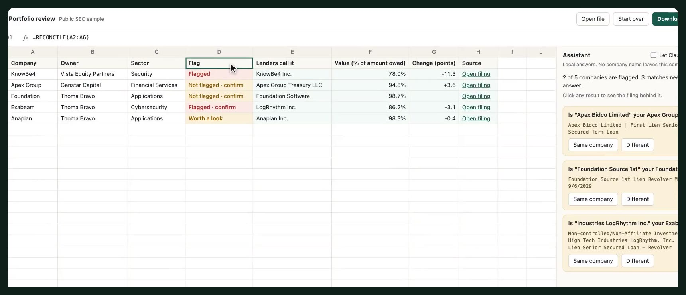
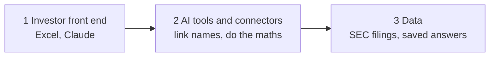

# Alexandre Cela

**I build data and AI products for private capital, end to end.**

Private capital is money invested in companies and loans that don't trade on a stock exchange. These investors decide with little public data. I turn their messy documents into data they can trust, then into tools that speed up their decisions.

### Example: Lender Watch, a proof of concept

**For LPs and GPs: see which of your companies lenders are marking down, in minutes, from a spreadsheet or Claude, with the SEC filing behind every number and a person settling anything unclear.**

[Watch 59 seconds](https://alexandrecela10.github.io/projects/lender-watch/#watch) · [Demo](https://lender-watch.streamlit.app) · [Case study](https://alexandrecela10.github.io/projects/lender-watch/) · [Code](https://github.com/alexandrecela10/lender-watch)

It shows how I approach AI adoption in private equity. Tools and connectors fit into the work people already do, and give answers they can check. Underneath sits organised data: one identity per company, and a source for every value. No investor has tested it yet.

### What I've shipped at work

| Product | Example Persona | Example Private capital use case | Job to be done | Result |
|---|---|---|---|---|
| Benchmarking product (BlackRock and Preqin), first client-facing end-to-end version | Deal team at a private equity firm | Comparing a company they want to buy with similar past deals | When I price an acquisition, I want to see what similar companies sold for and how those deals performed, so I can set my bid and test my return assumptions | Better deal pricing, faster. More deals, better returns |
| Loan data from 6,000+ unstructured BDC filings | Deal team at private credit firm | Portfolio Monitoring, Portfolio Protection | Identifying segment of markers showing distress, and whether the portfolio is exposed | Increased and timelier visibility on Private Credit Distress, reducing likelihood of loans defaulting |

### How I build

- Use AI where it beats fixed rules, not by default.
- Define what "correct" means before measuring quality.
- Make every output traceable to its source. If users can't check it, they won't trust it.
- Treat monitoring and governance as part of the product.

### Side projects

Prototypes and proofs of concept, built outside work on public or made-up data so anyone can try them. My main work is at BlackRock, with real data for real clients, and isn't shareable.

**[See all projects with case studies and demos →](https://alexandrecela10.github.io)**

| Project | Investment stage | Who it's for | What they get | |
|---|---|---|---|---|
| Alpha Scout | Sourcing | Junior investor at a startup fund | A scored shortlist of startups that fit the fund, before they ask for money. Every score has a quote and a link | [Case study](https://alexandrecela10.github.io/projects/alpha-scout/) · [Demo](https://alpha-scout-3ygbqjh8aw4qrkzrzfkjei.streamlit.app) |
| Deck Rank | Screening | Junior investor at a startup fund | The best pitch deck read first. Every score quotes the slide it came from | [Case study](https://alexandrecela10.github.io/projects/deck-rank/) · [Demo](https://deck-rank.streamlit.app) |
| Secondaries Radar | Sourcing and screening | Secondaries team at a large investor | Whether an offer deserves an NDA within minutes, with a price view from their own fund data, and which pensions may sell | [Case study](https://alexandrecela10.github.io/projects/secondaries-radar/) · [Demo](https://secondaries-radar.streamlit.app) |
| Portfolio Answer Desk | Monitoring | Portfolio analyst at a large LP | The right number, with its sources, in minutes when the CIO asks about the portfolio | [Case study](https://alexandrecela10.github.io/projects/portfolio-answer-desk/) · [Demo](https://portfolio-answer-desk.streamlit.app) |

### How I work

I run product work through **[PM OS](https://github.com/alexandrecela10/PM-OS)**. It started from [Aakash Gupta's PM OS](https://www.news.aakashg.com/p/pm-os), which I customised into my own set of 48 product skills in Claude Code and Devin. It takes an idea from opportunity check to PRD, review by 7 AI reviewers, build and results. Each correction I make becomes a rule. AI does the repetitive work. I decide what matters and what ships.

**Tools:** Claude Code, Devin, Python, Streamlit, LangFuse (AI monitoring), DoWhy (causal inference), dbt, Snowflake.

When I'm not building, I'm working on my backhand, in the gym, or out on a walk.

[LinkedIn](https://www.linkedin.com/in/alexandrecela/) · [Portfolio](https://alexandrecela10.github.io) · alexandrecelap@gmail.com
